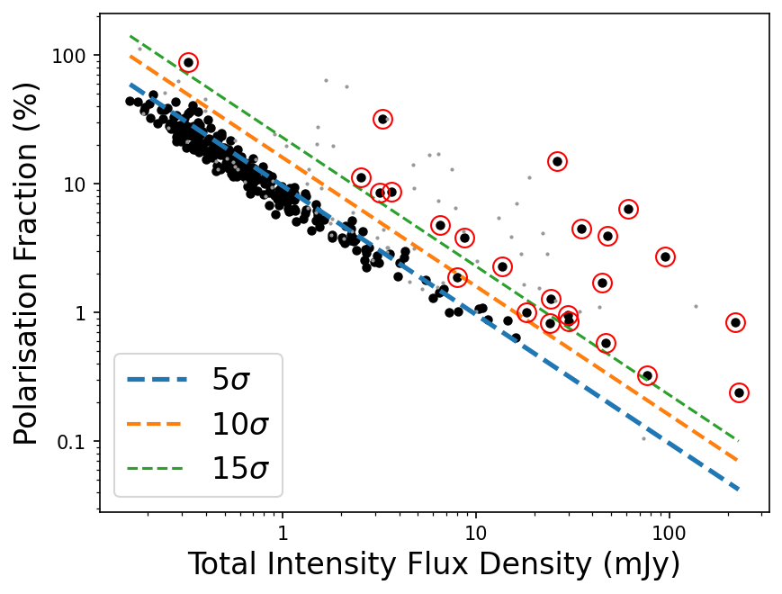
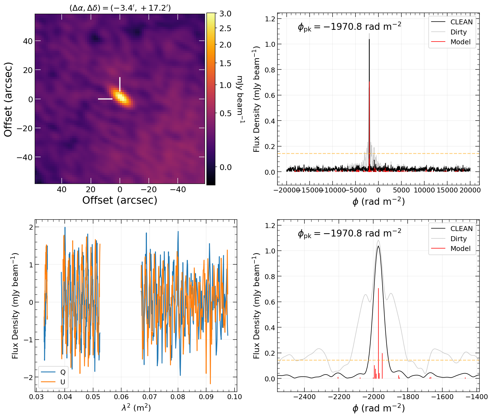
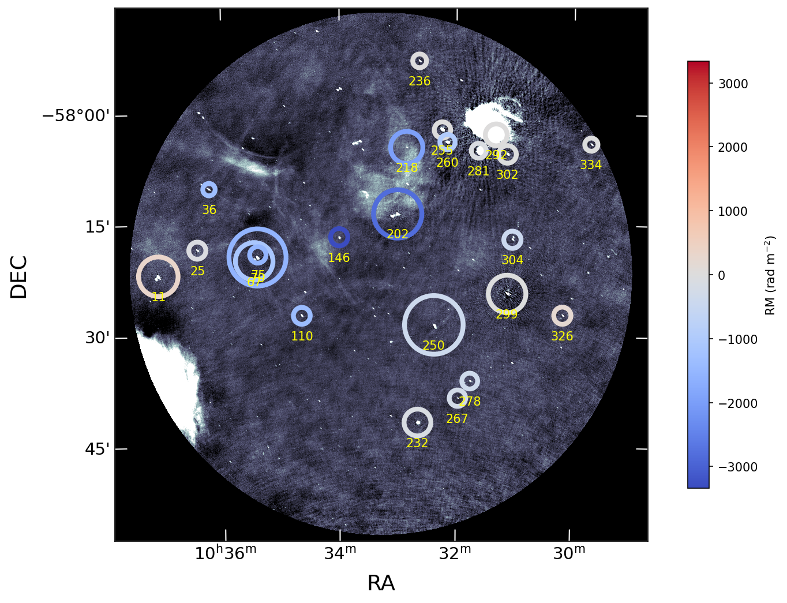

# A Beamforming Approach to RM Determination

## Basic Idea

These scripts are provided to enable rapid RM characterization
using beamformed visibilities. For a given list of sky positions,
we can apply the appropriate phase offsets and extract visibility
averaged intensities per polarization, frequency channel, and time
sample. By then averaging in time we get the full frequency resolution
spectra in Stokes I, Q, U, and V.  Using the full resolution Q and U
spectra we can then run RM synthesis to measure the Faraday spectrum
and from this the RM and peak polarized intensity.

Since beamforming is just multiplying by a phase offset and summing,
it is much faster than standard interferometric imaging.  This speedup
is substantial, especially for wide fields of view and large numbers
of channels.  However, these are not mathematically equivalent, and
Q U channel imaging (and CLEANing) will always give the more precise
measurement of polarized flux and RM.  The beamforming approach is
equivalent to making dirty images of each channel and then extracting
data from pixels centered on each target position.  While this will
not be an exact representation of the polarized sky, it is sufficient
for quickly identifying interesting polarized sources and measuring
their RMs.

In the following, we will give a recipe for running the scripts for
beamforming and RM synthesis to go from a CASA measurement set to
a catalog of RMs.


## Installation and Requirements

For the beamforming, the main requirement is `casatools`, which
is needed to read the visibilities in CASA measurement set format.
For the RM synthesis we are using
[RM-Tools](https://github.com/CIRADA-Tools/RM-Tools), which needs
to be installed independently.  For MMGPS, I'm using the 
`MMGPS_EDD_042024.simg` singularity image for `casatools` during 
the beamforming stage.  For all else, I have locally installed 
`RM-Tool`. 


## Preliminaries and Prerequisites

This software is specifically tailored to processing MMGPS data, but may be
applied to other data sets.  The assumed data structure is a set of CASA
Measurement Sets (MS) where each spectral window has its own MS (e.g.,
`MSGPS_L_1184_spw004.ms`).  It also requires a source catalog in FITS format
that is (mostly) a pyBDSF catalog.


## Run beamformer to extract IQUV spectra

With a catalog and data set, we can now run the beamforming code to 
extract the IQUV data from the measurement sets. The script we will need is
`run_beamform.py`, which is in the `bf` folder.  If we run with `-h` we can see
the usage:

```
usage: run_beamform.py [-h] --catfile CATFILE [--cat_max_sep CAT_MAX_SEP] [--cat_isl_filter] --outbase OUTBASE
                       [--outdir OUTDIR] [--nproc NPROC] [--uv_taper_lam UV_TAPER_LAM] [--field FIELD] [--no_weights]
                       [--no_flags] [--use_data_col]
                       ms_files [ms_files ...]

Extract beamformed IQUV dynamic spectra from MS data

positional arguments:
  ms_files              Path to data Measurement Set(s). If each spw has its own MS, then each should end in 'spw[num].ms'

optional arguments:
  -h, --help            show this help message and exit
  --catfile CATFILE     Path to input source catalog
  --cat_max_sep CAT_MAX_SEP
                        Pre-filter: Max sep from phase center in arcmin (default: -1, no limit)
  --cat_isl_filter      Pre-filter: Only keep one source per island (def: do NOT filter)
  --outbase OUTBASE     Base name for output files
  --outdir OUTDIR       Output directory for beam data (def: cwd)
  --nproc NPROC         Number of parallel processes
  --uv_taper_lam UV_TAPER_LAM
                        Lower baseline taper in wavelengths (default: 0, no taper)
  --field FIELD         CASA field number of target (def=0)
  --no_weights          Ignore visibility weights (def: False)
  --no_flags            Ignore MS data flags (def: False)
  --use_data_col        Use DATA column (def: use CORRECTED column)
```

where `catfile` is our FITS input catalog and `ms_files` are the input MS
files.  One can also run a preliminary filter on the sources in the FITS
catalog, if so desired.  Right now these include a maximum distance from
pointing center (`cat_max_sep`) and a PyBDSF Island filter (`--cat_isl_filter`)
which will take the brightest component on a source ``island''.  The `outbase`
is the desired base name for all output, `outdir` is the directory where you
want the beam data to be written (each beam will get its own directory under
this), `uv_taper_lam` sets an inner cutoff (in wavelengths) that is a cheap way
of downweighting the shorter baselines, `field` is the field ID of the target
in the measuremen set, `nproc` is the number of processes to run
simultaneously, `no_weights` ignores the visibility weights in the measurement
set, `no_flags` ignores the flags in the measurement set, and `use_data_col`
says that we should use the `DATA` column and not the default `CORRECTED_DATA`
column.

One note of caution is that we are using the python package `multiprocessing`
to run the parallel processing specified by `nproc`.  This works very well, but
if you are running a machine with OpenMP, you should set the following
environment variable:

```
export OMP_NUM_THREADS=1
```

Here's an example of running the beamformer:

```
singularity exec MMGPS_EDD_042024.simg python ~/src/mmgps_beamform/bf/run_beamform.py --catfile cats/Image_MSGPS_L_1184_Loop04-MFS-image-pbcor_gaul_bdsfcat_final.fits --outbase L1184 --outdir beams --nproc 10 --uv_taper_lam 2800 selfcal_data/MSGPS_L_1184_spw0*ms
```

When running, you will see something like this in the output directory:

```
> ls beams/
beam00000  beam00001  ...  beam[N]
L1184_20261021T115434.log
Image_MSGPS_L_1184_Loop04-MFS-image-pbcor_gaul_bdsfcat_final_beams.fits
```

There are folders for each beam (containing the data), a copy of the catalog 
(with optional filters applied) where each beam number corresponds to the 
row in the FITS table, and a log file.  Looking inside one of the beam folders, 
you will see that the spectral windows are each being processed separately.

```
> ls beam00000
spw00_beam00000_step000.npy  spw01_beam00000_step000.npy
spw02_beam00000_step000.npy  spw03_beam00000_step000.npy
```

These are intermediate data products and will be combined into one file at the
end.  All beams are being processed at the same time and each spw is processed
sequentially.  For me, each spw took about 40 seconds each, and total
processing was about 10 minutes.  More beams will take longer, of course, but
not by a ton.  The slowest part of the process is just reading the measurement
set files and all the beams are read at the same time.

Now that processing is done, let's take a look to see what was produced.  In
the output directory we now have:

```
> ls beams/
beam00000  beam00001  ...  beam[N]
L1184_20261021T115434.log
Image_MSGPS_L_1184_Loop04-MFS-image-pbcor_gaul_bdsfcat_final_beams.fits
L1184_freqs.npy
```

We get a log file, the beam data folders, and a `npy` file containing each of
the channel frequencies of the full band (ie, combining all the spectral
windows) in Hz.  The `times` folder contains the time stamps for each time
sample, which we won't really need.

Each of the beam folders now just contains one spw-combined data file.  For
example in beam0 we find the file `test_beam00000_full.npy`, where `test` is
the output base we gave.  The data files are just numpy arrays with shape `(4,
Nt, Nf)` where 4 is the number of stokes parameters (I, Q, U, V), `Nt` is the
number of time samples, and `Nf` is the number of frequency channels.


## Run RM-Sythesis and RM-CLEAN 

Now that we have prepared the data, we can run RM synthesis.  We will just be using
[RM-Tools](https://github.com/CIRADA-Tools/RM-Tools), so that package needs to be
installed for this script to run.  The script we are using is called `rm_proc_beams` 
and we can see it's usage here:

```
usage: rm_proc_beams.py [-h] [--outdir OUTDIR] --freqfile FREQFILE [--maskfile MASKFILE] [--keep_zeros] [--niter NITER]
                        [--threshold THRESHOLD] [--phimax PHIMAX] --catfile CATFILE [--use_obs_errs] [--nproc NPROC]
                        dat_files [dat_files ...]

Make time and spectrum plots for IQUV data in beams

positional arguments:
  dat_files             Beam data file(s) for RM CLEAN-ing

options:
  -h, --help            show this help message and exit
  --outdir OUTDIR       Output directory (def: cwd)
  --freqfile FREQFILE   npy array of channel frequencies in MHz
  --maskfile MASKFILE   npy array of channel mask (1=use chan, 0=skip chan)
  --keep_zeros          Do NOT flag zeros in spectrum (default = False)
  --niter NITER         Number of CLEAN iterations (def=200)
  --threshold THRESHOLD
                        CLEAN threshold in (neg) sigma (def=-2)
  --phimax PHIMAX       Maximum Faraday depth (rad/^2, def: -1, no max)
  --catfile CATFILE     FITS catalog file to add results to
  --use_obs_errs        Use obs errors from RM-tools in catalog (default = False)
  --nproc NPROC         Number of parallel processes to run (def=1)
```

The `dat_files` are the `*npy` files produced by the beamforming step.  You 
can list them individually or use some wildcard.  The `outdir` is the top of 
the output directory for the RM-tools data products (they will be grouped into 
sub-directories by beam). The `freqfile` is the `*npy` file of the channel 
frequencies in MHz.  You can optionally provide a `maskfile` as a `*npy` array 
where 1 means use the channel and 0 means mask the channel.  By default, the 
channels with total intensity equal to zero will be ignored.  If, for some 
unforeseeable reason, you wish to include these, use the `keep_zeros` option, 
but note that zeros in the input to RM-Tools will cause it to fail. The options 
`niter` and `threshold` are RM-CLEAN options that set the stopping conditions for 
CLEAN.  The `phimax` option is the highest Faraday depth magnitude to search.
The `catfile` option is the FITS catalog for the beams.  It will be read in and 
a copy (appended with "RM") will be produced containing the RM, PI, SNR, and 
associated errors for each source.  We want to use the "observed errors" from 
RM-Tools, so we will include the `use_obs_errs` flag.  Finally, you can set the 
number of parallel processes to run with `nproc`.  This step is *highly* pallelizable 
and does not use much memory, so you can often get a huge speed-up by using 20 or 
30 processes.

An example run would be:

```
python rm_proc_beams.py --outdir rm_spec --freqfile beams/L1184_freqs.npy --phimax 20000 --cat beams/Image_MSGPS_L_1184_Loop04-MFS-image-pbcor_gaul_bdsfcat_final_beams.fits --use_obs_errs --nproc 20 beams/beam*/*_full.npy
```

The output will look something like this:

```
$ ls rm_spec

beam00000_full  beam00002_full  beam00003_full  [...]
Image_MSGPS_L_1184_Loop04-MFS-image-pbcor_gaul_bdsfcat_final_beams_RM.fits
```

where the results are in the FITS table and the beam directories 
contain the outputs from RM-Synthesis and RM-CLEAN:

```
ls rm_spec/beam00000_full/
beam00000_full_cleanFDF-plots.pdf  beam00000_full_RMclean.json             beam00000_full_spectra-plots.pdf
beam00000_full_FDFclean.dat        beam00000_full_RMSF.dat                 beam00000_full.txt
beam00000_full_FDFdirty.dat        beam00000_full_RMSF-dirtyFDF-plots.pdf  beam00000_full_weight.dat
beam00000_full_FDFmodel.dat        beam00000_full_RMsynth.dat
beam00000_full_RMclean.dat         beam00000_full_RMsynth.json
```


## Make Pretty Plots 

After running the RM-Tools processes, we now have the Faraday spectrum for
every source.  But not all of these will be polarised.  In order to asses the
polarisation properties of all our sources and make cuts to find the actually
polarised sources, we have a script to make a few diagnostic plots.

Running with `-h` to see the options we have:

```
usage: rm_diagnostic_plots.py [-h] [--outdir OUTDIR] --catfile CATFILE --imfile IMFILE [--snr_cut SNR_CUT]
                              [--outbase OUTBASE] --rm_spec_dir RM_SPEC_DIR [--bfmt BFMT] [--phi_win PHI_WIN]
                              [--imsize IMSIZE] [--no_pfrac] [--no_cutouts] [--no_cutouts_select] [--no_rmplot]

Make RM diagnostic plots

options:
  -h, --help            show this help message and exit
  --outdir OUTDIR       Output directory for plots (def: cwd)
  --catfile CATFILE     FITS catalog of beam sources
  --imfile IMFILE       FITS Image of field
  --snr_cut SNR_CUT     Minimum PI SNR
  --outbase OUTBASE     Base of output files
  --rm_spec_dir RM_SPEC_DIR
                        Top of beam rm spec directory
  --bfmt BFMT           fstring format of beam name
  --phi_win PHI_WIN     Size of RM Spec zoom panel in units of RMSF (def:10 * RMSF)
  --imsize IMSIZE       Size of RM sky plot in degrees (def:1.5)
  --no_pfrac            Do NOT make pol frac plot
  --no_cutouts          Do NOT make cutout plots for ALL sources
  --no_cutouts_select   Do NOT make cutout plots for THRESHOLD sources
  --no_rmplot           Do NOT RM image plot
```

We will discuss the options when we discuss each of the three plots that can be produced.

Here's an example run:
```
python rm_diagnostic_plots.py --outdir plots --catfile rm_spec/Image_MSGPS_L_1184_Loop04-MFS-image-pbcor_gaul_bdsfcat_final_beams_RM.fits --imfile Image_MSGPS_L_1184_Loop04-MFS-image-pbcor.fits --snr_cut 10 --outbase L1184 --rm_spec_dir rm_spec --imsize 1.2
```
The plots are all put in `outdir` and are named starting with a base name `outbase`.

### Polarization Fraction vs Total Intensity 
To get a sense for how many truly polarised sources we have, we can make a plot 
showing the polarisation fraction as a function of the total intensity.  The total 
intensity flux comes from the initial source catalog.  Dashed lines denote the 
polarised intensity SNR.  The light grey points have been filtered out due to 
the island filter.  That means that they are a fainter component on a source 
island.  The sources marked in red have survived the filter and have met the 
SNR threshold set by `snr_cut`.  

Here's an example:



If you don't want to make the plot, included the ``--no_pfac`` option.


### Individual Candidate Inspection
Since this whole technique is approximate and susceptible to sidelobes and 
such, it can be very useful to examine the data products produced for 
each source. This summary plot for each source looks like this:



and includes a cutout of the total intensity map in the top left, the 
full RM range of the Faraday spectrum (top right), a zoomed in view 
around the peak of the Faraday spectrum (bottom right), and the 
QU spectrum (bottom left).  The size of the zoomed in version of the 
Faraday spectrum is set by the `phi_win` parameter and is given in 
terms of the FHWM of the RMSF.  By default we show `10 * RMSF FWHM`.

These plots are made for all sources and placed in the `all` subdirectory 
and also for the select candidates that meet the SNR threshold and placed 
in the `select` subdirectory.

If you don't want to make these plots for every single candidate, included the ``--no_cutouts`` option.  If you don't want to make them for the select candidates, use ``--no_cutouts_select``.

### Preliminary RM Map 



If you don't want to make the plot, included the ``--no_rm_plot`` option.
